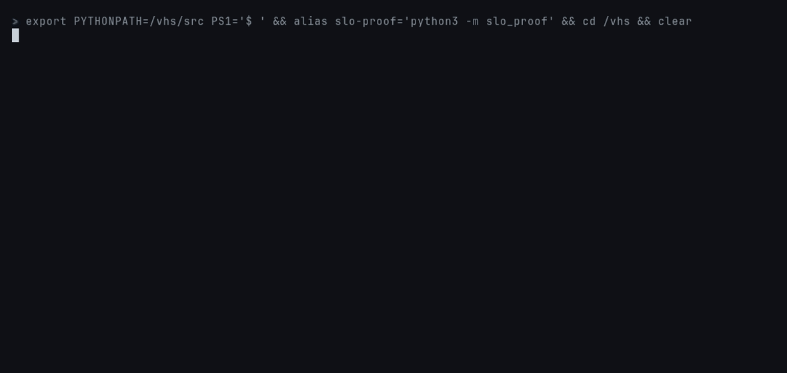

# slo-proof

[](https://github.com/ahmed-hashim-pro/slo-proof/actions/workflows/ci.yml) [](LICENSE)

Replays past SLI data against a proposed alert rule before it goes live. For
each rule it reports:

- which past incidents the rule would have caught, and how late
- how much error budget burned before it paged
- how often it would have woken someone for nothing

Alert rules are usually tested by waiting: ship the rule, then find out at
3 a.m. that it pages on every overnight traffic dip, or find out in a
post-mortem that it never fired for the slow burn that ate half the month's
budget. The data to answer both questions is already in your metrics. This
tool replays it through the rule, evaluated the way Prometheus evaluates
alerting rules, and scores the pages against the incidents you know about.

```
$ slo-proof compare examples/sli.csv examples/incidents.csv examples/rules.toml
28.0 days, 6 incidents that deserved a page, SLO 99.9%

    rule                      caught  median delay  false/week  late  precision  firing, no incident
1   workbook-multiwindow         6/6            6m         0.0     0       100%                1h39m
2   fast-burn-only               5/6            4m         0.0     0       100%                  20m
3   6x-over-6h                   4/6           17m         0.2     0        80%               18h43m
4   static-1pct                  3/6            6m         0.8     2        62%                1h56m

ranked by incidents caught, then false pages per week, then median delay.
missed:
  static-1pct: hard outage, slow burn, short blip
  fast-burn-only: slow burn
  6x-over-6h: flapping dependency, short blip
```

The example is a synthetic month whose incidents are known exactly (see
[below](#the-example-month)). Each of the four rules fails in a way you could
only learn from the data:

- **`static-1pct`** pages when more than 1% of requests fail for 5 minutes.
  - It misses the 4-minute hard outage and the 2-minute blip, because
    `for: 5m` outlasts both. Both pages arrive after the incident is over.
  - It sleeps through the slow burn, which never crosses 1% yet spends 10% of
    the monthly budget.
  - It pages three times on overnight traffic dips. Six requests a minute
    with one failed health check is a 17% error ratio, and almost no budget.
- **`fast-burn-only`** is the SRE Workbook's 14.4x-over-1h page, used alone.
  It's quick and it never pages falsely, but it misses the slow burn entirely.
- **`6x-over-6h`** is a single long window with no short window to reset it.
  - It catches the slow burn.
  - A 4-minute outage then keeps it firing for 6 hours after recovery: 18
    hours of alerting over the month with no incident open.
  - It misses the flapping dependency and the blip.
- **`workbook-multiwindow`** is the Workbook's recommended pair, 14.4x over
  1h & 5m OR 6x over 6h & 30m. It catches all six incidents with no false
  pages. It's still not fast at everything: the slow burn takes 4h53m to page,
  and 5.5% of the month's budget is gone by then. The table tells you that
  before an incident does.




## Quickstart

You need Python 3.11 or newer. The tool itself has no dependencies.

```bash
git clone https://github.com/ahmed-hashim-pro/slo-proof && cd slo-proof
pip install -e .            # in a virtualenv; '.[dev]' adds the test tools

slo-proof compare examples/sli.csv examples/incidents.csv examples/rules.toml
slo-proof replay  examples/sli.csv examples/incidents.csv examples/rules.toml --rule workbook-multiwindow
slo-proof plot    examples/sli.csv examples/incidents.csv examples/rules.toml -o month.svg
slo-proof check   examples/rules.toml
slo-proof synth   --seed 3 --out mymonth/       # another synthetic month
```

With `--fail-on-miss`, `replay` and `compare` exit 1 when a rule misses an
incident that deserved a page. That lets a change to an alert rule be gated
in CI on last quarter's incidents.

## Your own data

**The SLI** is a CSV with one row per minute, giving that minute's good and
total events:

```
timestamp,good,total
2026-03-02T00:00:00Z,598,600
2026-03-02T00:01:00Z,611,611
```

Timestamps must have a timezone, sit on minute boundaries, and run one
minute apart with no gaps. A missing minute could mean "no traffic" or "the
exporter was down", and the two give different answers, so a minute with no
traffic must be written as a row of zeros.

From Prometheus, export two range queries at a 60 s step and convert them:

```bash
# sum(increase(http_requests_total[1m]))  and  sum(increase(http_requests_total{code=~"5.."}[1m]))
slo-proof from-prom --total total.json --bad errors.json -o sli.csv
```

**Incidents** are what actually happened:

```
start,end,severity,name
2026-03-04T13:41:00Z,2026-03-04T13:45:00Z,page,checkout outage
2026-03-21T23:09:00Z,2026-03-23T11:09:00Z,ticket,slow disk on one shard
```

`page` incidents are the ones a rule has to catch, and they count toward
recall. `ticket` incidents were real but could wait: a page during one isn't
counted as false, and missing one isn't counted against the rule. Incidents
may not overlap, because a page could then not be attributed to one of them.

**Rules** are TOML:

```toml
[slo]
target = 0.999
period = "30d"            # the budget period; default 30d

[[rule]]
name = "workbook-multiwindow"
for = "0m"                # optional, as Prometheus `for:`
  [[rule.when]]           # fires if ANY `when` holds,
  burn = 14.4             # and a `when` holds if the error ratio is above
  windows = ["1h", "5m"]  # the threshold over EVERY one of its windows
  [[rule.when]]
  burn = 6
  windows = ["6h", "30m"]
```

A `when` takes `burn`, a multiple of the budget rate (1 − target), or
`error_ratio`, an absolute fraction. That covers a static threshold, a
single-window burn rate, and multiwindow, multi-burn-rate alerts.

Every input is parsed strictly. Errors in the CSVs and the rules give a
file and line:

```
$ slo-proof compare gappy.csv examples/incidents.csv examples/rules.toml
slo-proof: gappy.csv: line 3: gap of 4 minutes after 2026-03-02 00:00; write a row of zeros for a minute with no traffic
```

The same goes for an unknown key in the rules (a misspelt `windows` would
otherwise make a rule that silently never fires), a timestamp without a
timezone, overlapping incidents, and a burn rate that would need an error
ratio above 100%. Errors in a Prometheus export name the file, and a line
only when the JSON itself is malformed.

## How it decides

### Evaluation, as Prometheus would do it

- **When it evaluates.** The rule is evaluated at the end of every minute.
- **Windows.** A window of W minutes covers the last W complete minutes. Its
  error ratio is bad events over total events, the value
  `sum(increase(bad[W])) / sum(increase(total[W]))` gives over per-minute
  recording rules.
- **No traffic.** A window with no events has no ratio, so it never fires.
  In PromQL 0/0 is NaN, and NaN > x is false.
- **Early windows.** A window that reaches back before the first minute uses
  the data there is, as a range selector does.
- **`for`.** The first evaluation where the expression holds makes the alert
  pending. It fires at the first evaluation at least `for` later, and every
  evaluation in between must also hold. It resolves at the first evaluation
  where the expression is false. A later true evaluation starts a new pending
  period.
- **Pages.** Each transition to firing is one page.

Two simplifications, stated:

- **No extrapolation.** Prometheus's `increase()` extrapolates to the
  window's edges, while this sums whole minutes exactly. The difference is a
  fraction of a minute's events at each edge.
- **No Alertmanager.** Its grouping and repeat intervals aren't modelled.
  They change how often you're reminded, not whether or when the first page
  goes out.

### Scoring

| A page is | when it fires |
| --- | --- |
| **true** | while an incident is open |
| **late** | within an hour after an incident ended: about something real, but nobody could act on it |
| **false** | otherwise |

- **Detection.** An incident is detected if the rule is firing at any moment
  while it's open. The delay is measured from the incident's start; it's
  zero if the rule was already firing then. A late page detects nothing.
- **Budget spent before detection** is the incident's bad events from its
  start until the page, as a share of the budget period's error budget at
  the data's average traffic.
- **Firing, no incident** is the time a rule spent firing while no incident
  was open. That's where a long window without a short one shows its cost.
- **Ranking** is by incidents caught, then false pages per week, then median
  delay. It's a default, not a verdict: the table has the numbers for any
  other order.

## The example month

`slo-proof synth` writes a month with a daily and weekly traffic rhythm,
Poisson noise, and a background error ratio of a fifth of the budget rate.
Into that it places one of each kind of trouble that tells alert rules
apart:

| Kind | Shape | Severity |
| --- | --- | --- |
| hard outage | every request fails for 4 minutes | page |
| sharp spike | a quarter of requests fail for 10 minutes | page |
| partial outage | one shard in ten down (10% errors) for 40 minutes | page |
| flapping | 8% errors for 4 minutes in every 10, for an hour | page |
| slow burn | 0.7% errors (7x the budget rate) for 8 hours | page |
| very slow burn | 0.25% errors (2.5x) for 36 hours | ticket |
| short blip | half of requests fail for 2 minutes | page |
| traffic dips (three) | traffic falls to ~1% at night while health checks fail | not an incident |

The seed moves each incident by up to an hour; the committed example is
seed 7. The findings above aren't an accident of one month. A test re-checks
them on eight different seeds:

- the multiwindow rule catches everything with no false pages
- fast-burn-only misses exactly the slow burn
- the static threshold misses the outage, the blip and the slow burn, and
  pages on the dips
- the 6h window fires for over eight hours with no incident open

## How it is tested

`pytest` runs 71 tests in under 10 seconds.

- **The evaluator against a reference.** The reference is written another
  way: it sums each window by hand and fires wherever the expression held at
  every evaluation of the last `for` minutes. Hypothesis checks the two agree
  on 400 random series and rules, with up to three ORed conditions of up to
  three windows each. Further properties: alerts are ordered and disjoint,
  and a longer `for` never pages more.
- **Hand-built cases** for `for` semantics:
  - firing at once with `for = 0`
  - a false evaluation resetting the pending clock
  - still firing at the end of the data
  - all windows required, any condition enough
  - no traffic never firing
- **Scoring:**
  - true, late and false pages on a constructed timeline
  - detection when the rule was already firing at the start
  - budget arithmetic
  - firing time with no incident
  - ranking order
- **Parsers.** 43 cases of input that must be refused, each checked for its
  message and its line number (or for having none, when the problem is the
  whole file or a Prometheus export's contents): gaps, duplicates, missing
  timezones, typos in rule keys, impossible burn rates, overlapping
  incidents, malformed Prometheus exports.
- **The example month.** It's reproducible from its seed, the committed
  files match what `synth` writes, and the README's findings hold on eight
  seeds.
- **The CLI.** Exit codes, `--fail-on-miss`, line numbers in errors, plots,
  and `check`.

CI runs:

- the tests on Python 3.11 and 3.13
- ruff and `mypy --strict`
- a check that `examples/` and `docs/` match what the current code generates

## What this does not do

- **It replays the past.** A rule that would have caught last quarter's
  incidents can still miss a new kind. The synthetic month exists to cover
  kinds your history hasn't produced yet.
- **One SLI per run.** Rules that combine several services, or route by
  label, need one replay per series.
- **No Alertmanager.** Inhibition, grouping, silences and repeat intervals
  are outside the model. So is evaluation jitter: Prometheus evaluates
  "every minute" on its own schedule, not on the minute boundary.
- **No extrapolation** in window sums (see above). For windows of an hour or
  more the difference is negligible; for a 1-minute window it isn't.
- **Incident records are taken as true.** If the incident's recorded start
  is when someone noticed, not when users noticed, every delay here is
  measured from the wrong moment. The tool can't know; the synthetic month
  is the one place where it does.

## License

MIT
